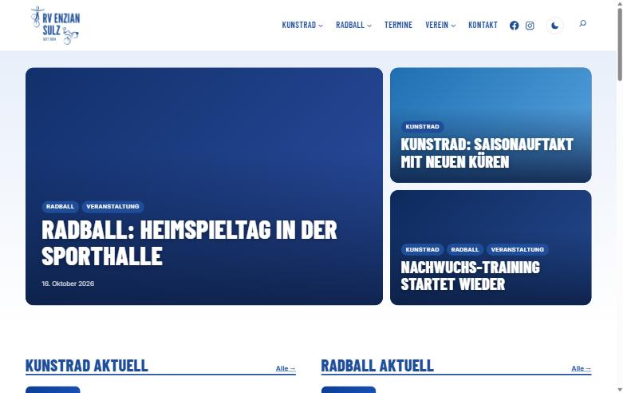
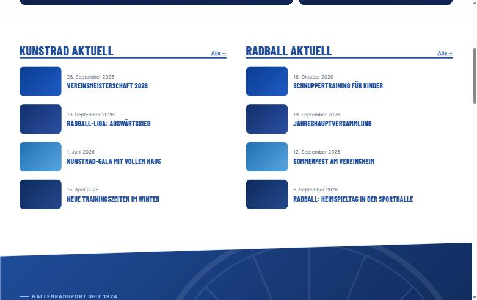
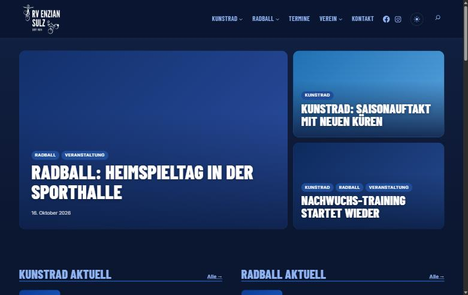
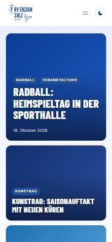

# RV Sulz – WordPress-Theme

Block-Theme für den **RV Enzian Sulz** (Kunstrad & Radball, seit 1924) – [wordpress.rv-sulz.at](http://wordpress.rv-sulz.at).
Modernes Vereinsdesign in Enzian-Blau, Einstellungen wie bei HybridMag, Dunkelmodus und lokal eingebundene Schriften (DSGVO-freundlich).



| News Kunstrad & Radball | Dunkelmodus | Handy |
|---|---|---|
|  |  |  |

> Die Screenshots verwenden farbige Platzhalter und Beispieltitel statt der echten Beiträge.

## Funktionen

- **Startseite** mit Top-Beiträgen, News-Spalten **Kunstrad | Radball**, Sparten-Band,
  Neuigkeiten-Raster und „Komm ins Training!“ – alles einstellbar unter *Customizer → Startseite*
  (Kategorie, Anzahl, Überschrift, ein-/ausblenden).
- **Seiten /kunstrad/ und /radball/** mit automatisch den neuesten Beiträgen der Kategorie.
- **Menüs und Fußbereich wie bei HybridMag**: Pflege unter *Design → Menüs* und *Design → Widgets*,
  Positionsnamen wie bei HybridMag, damit die Zuordnung beim Theme-Wechsel erhalten bleibt.
- **Dunkelmodus** nach Geräteeinstellung plus Umschalter, weißes Logo im Dunkelmodus.
- **Termine** aus dem Plugin „Simple Calendar“ im Theme-Design (Monats- und Listenansicht).
- **Schriften** Inter und Barlow Condensed lokal eingebunden – keine Verbindung zu Google.

## Installation

1. Neueste Version bauen (siehe unten) oder ZIP aus `dist\` nehmen.
2. WordPress: *Design → Themes → Theme hinzufügen → Theme hochladen* → `rv-sulz-<version>.zip`
   (bei einem Update „Aktuelle Version ersetzen“). Benötigt WordPress 6.6+.
3. Einstellungen unter *Design → Customizer → Startseite* bzw. *Fußbereich*.

Ausführliche Anleitung: [`rv-sulz/readme.txt`](rv-sulz/readme.txt) · Änderungen: [`CHANGELOG.md`](rv-sulz/CHANGELOG.md)

## Neue Version veröffentlichen

```powershell
powershell -ExecutionPolicy Bypass -File tools\build.ps1 -Bump patch    # bzw. minor / major
# CHANGELOG.md ausfüllen, testen
powershell -ExecutionPolicy Bypass -File tools\build.ps1 -Force -Release -Push
```

Ergebnis: `dist\rv-sulz-<version>.zip`, Commit „Version x.y.z“, Tag `vx.y.z`, Upload zu GitHub.
Die Versionsnummer steht nur im Kopf von `rv-sulz/style.css`.

## Projektstruktur

```
rv-sulz/              Theme (wird als ZIP hochgeladen)
  templates/, parts/    Block-Vorlagen (Startseite, Seiten, Header, Footer)
  patterns/             Bausteine (Hero, News, Sparten, Mitmach-Aufruf …)
  inc/                  Menüs, Startseiten- und Fußbereich-Einstellungen
  assets/               Schriften, Logos, Kalender-CSS
  theme.json            Farben, Schriften, Abstände
tools/build.ps1       Build & Versionierung
docs/screenshots/     Bilder für diese Seite
dist/                 gebaute ZIPs (nicht im Repository)
```

## Lizenz

GPL v2 oder später. Schriften: SIL Open Font License.
